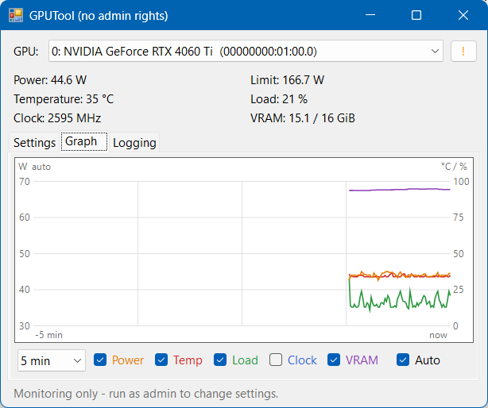

# GPUTool

A small, portable Windows tool to **set the power limit** of NVIDIA GPUs and **monitor** them — a simple GUI on top of `nvidia-smi`.

It was made for data-center cards like the **Tesla V100, T4 or P4**, where tools such as MSI Afterburner don't work, but it runs with any NVIDIA GPU that `nvidia-smi` supports (GeForce, Quadro, Tesla).

<!-- Add your own screenshots to docs/ and they will show up here -->


## Features

- **Power limit** per GPU, via slider or number field, always with a confirmation prompt
- **Live values**: power draw, power limit, temperature, load, SM clock, VRAM usage
- **History graph** over 1 / 5 / 15 / 60 minutes for power, temperature, load, clock and VRAM, with each series switchable on or off
- **Auto scaling** (optional): the axes fit the visible data with some headroom, e.g. a temperature curve between 30 and 60 °C is shown on a 15–75 °C axis. The axes zoom out at once when a value would leave the plot, and zoom back in only after 20 s, so the graph doesn't jump around.
- **Compact graph-only mode**: on the Graph tab, make the window smaller than the normal layout and only the graph remains, with the time range box and the current values in the header. In this mode the title bar is hidden: drag the graph to move the window, drag the thin frame to resize it. Right-click the graph for *Normal view*, *Always on top* and *Close*, or pull the window back to normal size to return.
- **Selectable curve colours**: click a coloured series name below the graph to choose its colour (clicking the box shows or hides the curve). Right-click the graph → *Reset colours* restores the defaults.
- **Smart transparency** (optional): the window fades to a chosen opacity while you work in other programs and becomes fully visible again as soon as the mouse is over it. It can be limited to the compact graph view, which works well together with *Always on top*.
- **Data logging** of all GPUs to a tab-separated text file (opens directly in Excel), with selectable path and interval
- **Autostart**: creates a Windows Task Scheduler task that re-applies the power limit after every boot
- **Multi-GPU**: all cards are listed and addressed by PCI bus ID, so there is no mix-up between cards
- **Startup self-check** (.NET, admin rights, nvidia-smi, driver, Task Scheduler)
- Resizable and DPI-aware window that reopens where you left it, no installation, a single small exe. Portable: all settings are kept in `GPUTool.ini` next to the exe.

## Requirements

- Windows 10 or 11
- .NET Framework 4.5 or newer (already included in Windows 10/11)
- NVIDIA driver with `nvidia-smi` (installed together with the driver)
- Administrator rights to change the power limit or the autostart task. Monitoring and logging also work without them.

## Download & usage

1. Download `GPUTool.exe` from the [Releases](https://github.com/Macci0/GPUTool/releases) page.
2. Put it into a folder that **all user accounts can access**, e.g. `C:\Tools\GPUTool\`.
   Don't use a personal folder like *Downloads* or *Desktop*. If you confirm the UAC prompt with a different admin account, that account can't open files in your profile.
3. Start it. The app asks for admin rights on its own. If you decline, it runs in monitoring-only mode.

| Tab | What it does |
|---|---|
| **Settings** | Choose a new limit → **Apply** (valid until reboot). **Set autostart** re-applies it after every boot, 30 s after start. **Remove autostart** deletes the task. **Smart transparency** sets the opacity used while the window is in the background. |
| **Graph** | History of the selected GPU. Left axis: watts. Right axis: °C / %. Clock and VRAM are shown in % of their maximum. **Auto** fits the axes to the data; without it the axes are fixed at 0 – max power limit and 0 – 100. Shrink the window below its normal size for the compact graph-only view. |
| **Logging** | Turn data logging on or off, choose the file and interval. The on/off state is remembered. |

The **`?`** button shows the system check and app info. If it turns into an orange **`!`**, there is a warning (e.g. no admin rights).

> **Note:** On Windows the power limit set by `nvidia-smi` is reset at every reboot (there is no persistence mode as on Linux). That's what the autostart task is for.

## Files

| File | Location | Content |
|---|---|---|
| `GPUTool.log` | next to the exe (fallback: `%TEMP%`) | app log: start, checks, errors, crash details |
| `GPUTool_data.txt` | same folder as the app log (changeable) | data log, tab-separated |
| `GPUTool.ini` | next to the exe (fallback: `%APPDATA%\GPUTool\`) | all settings: window position/size, compact view, selected GPU and tab, graph range, auto scale, visible curves, colours, transparency, always on top, logging |

Data log columns:
`Time  BusId  Name  Power_W  Limit_W  Temp_C  Clock_MHz  Load_pct  VRAM_used_MiB  VRAM_total_MiB`

## Antivirus false positives

Some antivirus programs (seen with **Avast**) silently terminate GPUTool after a few seconds. The behaviour of an unsigned exe that asks for admin rights, starts `nvidia-smi` every second and can create scheduled tasks looks suspicious to heuristic scanners.

If the window just disappears:
- add the GPUTool folder as an **exception** in your antivirus (Avast: *Menu → Settings → General → Exceptions*), or
- build the exe yourself from source (see below). The source is a single readable file.

## Build from source

No Visual Studio or SDK needed. Windows already ships the C# compiler:

```bat
git clone https://github.com/Macci0/GPUTool.git
cd GPUTool
build.bat
```

The result is `bin\GPUTool.exe`. The code is C# 5 / .NET Framework 4.x, in one file: [`src/GPUTool.cs`](src/GPUTool.cs).

Every push is also built by GitHub Actions. Pushing a tag like `v1.0.0` creates a release with the exe attached.

## Disclaimer

GPUTool only calls the official `nvidia-smi` tool, and power limits can only be set within the range the card's firmware allows. Still, use it at your own risk. Passively cooled cards (T4, P4, V100 PCIe) need sufficient airflow.

Not affiliated with or endorsed by NVIDIA. NVIDIA, Tesla and Quadro are trademarks of NVIDIA Corporation.

## License

Copyright © 2026 WickiM

GPUTool is free software: you can redistribute it and/or modify it under the terms of the
**GNU General Public License v3** (or, at your option, any later version), see [LICENSE](LICENSE).

In short: use it freely. If you distribute a modified version, publish its source code under the same license and keep the copyright notices, including the ones the app shows in its system check window. GPUTool comes with no warranty.
